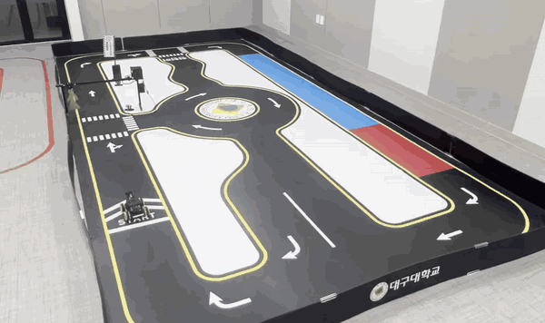
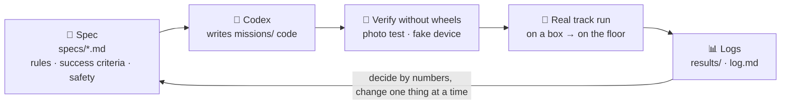
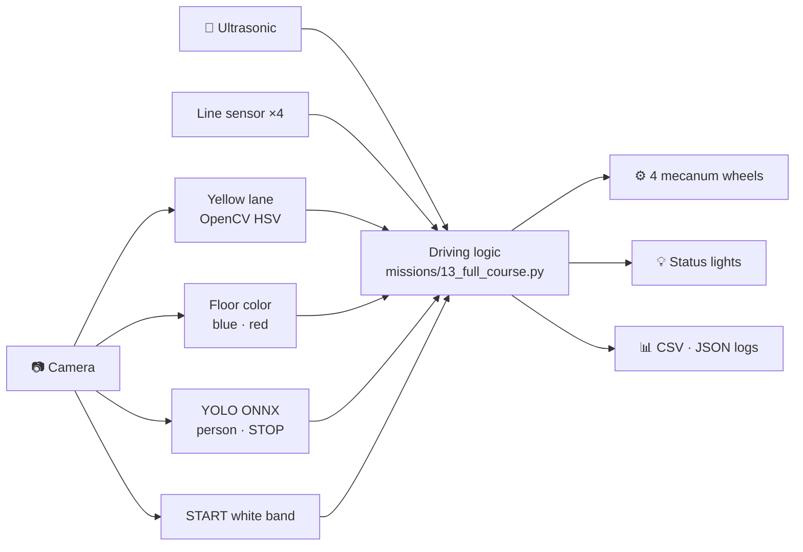

<div align="center">

# 🚗 Raspbot Autonomous Driving — Daegu Univ. PBL Team 3

**A small autonomous car that drives a full lap of the track with a single camera**<br>
It follows the lane, changes speed by floor color, stops for people and STOP signs, and stops by itself at the START line.


[한국어](README.md) · [Run guide (KR)](docs/RUN.md) · [Run logs](results/) · [Specs (KR)](specs/)



<sub>One lap of the outer loop on the school track · 4x speed · 2026-11-05</sub>

</div>

## At a glance

| Real-track laps | Corner accuracy | Full-route accuracy | Sign recognition |
|:---:|:---:|:---:|:---:|
| **7 / 7 runs** FINISH<br><sub>Nov 6, 37–44 s</sub> | **28% → 81%**<br><sub>photo test</sub> | **60% → 87%**<br><sub>photo test</sub> | **18 → 26 / 30**<br><sub>YOLO 320 → 640</sub> |

- **When**: Nov 1–6, 2026 (6 days) · Daegu University "AI Autonomous Driving Algorithm PBL"
- **Team roles**: leader · driver · track & signs · measurement · records & presentation. This repo is maintained by the **team leader**.
- **Hardware**: Yahboom RASPBOT-V2 (4 mecanum wheels · camera gimbal · ultrasonic · 4-channel line sensor · RGB lights) + Raspberry Pi 5

## Videos

**One lap of the outer loop** (external view, 33 s)

https://github.com/user-attachments/assets/10f29714-b9fe-476f-a1fe-a59d78784a65

**Last run · status lights** (Nov 6, robot camera view. The light color in the top-right corner is reconstructed from the run log)

https://github.com/user-attachments/assets/97b09148-425d-42a5-866d-6aba71688487

**Roundabout test** (18 s, leaves the lane at the end — next task)

https://github.com/user-attachments/assets/eed7b209-75b9-433f-b449-a0a8d11d4d99

<sub>Original quality: [outer loop](https://github.com/jihooni217/raspbot-pbl-3team/releases/download/demo-20261106/raspbot_outer_lap_20261105.mp4) · [roundabout test](https://github.com/jihooni217/raspbot-pbl-3team/releases/download/demo-20261106/raspbot_rotary_test.mp4)</sub>

## My role (team leader · led the project)

- **Spec-driven workflow, designed and written**: I wrote the spec for each feature (goal · rule table · numeric success criteria · safety) and set the working rules ([`AGENTS.md`](AGENTS.md)) so the AI (Codex) writes code only from those specs.
- **Integrated the demo program (No. 13)**: Combined lane following, floor-color speed, person/STOP stops and the START stop into one program, and tuned it on the real track myself until all 7 runs finished.
- **Verification and logging**: Checked every change with photo tests and fake-device tests before spinning any wheel, and saved every real run to `results/` as CSV/JSON to decide by numbers (60+ logged runs of the outer loop alone).
- **Root-cause analysis**: Lined up run logs with the robot's camera video to narrow down causes, and changed one thing at a time (see the case studies below).
- **Repo and presentation**: GitHub organization, demo plan, presentation materials.

<sub>**Team**: Some experiments such as the roundabout and the slow sign were done by teammates in their own branches (`mission-10-rotary`, `mission-08-slow-scurve-logo`) and PRs.<br>
**AI tools**: Code was written by Codex from the specs; robot checks over SSH, log organization and commits were assisted by Claude.</sub>

## How we built it



- Humans decide **what, why, and which number counts as success**; the AI writes the code. Safety rules (wheel speed cap 150, confirm before spinning wheels) are part of every spec.
- For corners, which are hard to repeat on the real track, we built a **photo test tool** ([`tools/photo_lap_test/`](tools/photo_lap_test/)) from 1,798 photos of a hand-pushed lap and compared versions by score.

## System overview



| Situation | Action |
|---|---|
| Normal | Follow the yellow lane at speed 35 · light green |
| Blue floor | Speed up to 80 · light blue |
| Red floor | Slow down to 25 · light blinks yellow |
| Person · STOP sign · obstacle within 25 cm | Stop · light red → resume when clear |
| After the red floor: START white band + all 4 line sensors white | Lap complete, stop |

## Main programs

| No. | Program | What it does |
|---|---|---|
| **13** | [`13_full_course.py`](missions/13_full_course.py) | **Demo code.** Outer loop · floor-color speed · stop for person/STOP/obstacle · stop at START · status lights (`--lights`) |
| 07 | [`07_lap_1757.py`](missions/07_lap_1757.py) | Camera yellow-lane following (base of 13) |
| 08 | [`08_command.py`](missions/08_command.py) | Korean text command → the AI picks **exactly one of 11 allowed actions** as JSON. Out-of-list, multi-action or unsafe requests are refused (guardrail) |
| 09 | [`09_dashboard.py`](missions/09_dashboard.py) | Browser control panel (autodrive ON · emergency stop · live log) |
| 14 | [`14_camera_align.py`](missions/14_camera_align.py) | Automatic camera angle correction before start |
| 05·06 | [`05_signs.py`](missions/05_signs.py) · [`06_drive_signs.py`](missions/06_drive_signs.py) | Detect people and STOP signs with YOLO, stop while driving |
| 04 | [`04_obstacle.py`](missions/04_obstacle.py) | Stop 25 cm before an obstacle using the ultrasonic median, resume above 35 cm |
| 02 | [`02_line.py`](missions/02_line.py) | Follow a black line with the line sensor |
| 03 | [`03_video.py`](missions/03_video.py) | Dashcam recording (time · distance · state overlay) |

## Case studies

<details>
<summary><b>① Car drifting into the wall at corners — no baseline, so fixes made it worse</b></summary>

- **Problem**: The more we changed the lane code, the more the car hit the wall or stopped at corners. With many versions mixed up, we could not tell which one was better.
- **Approach**: Built a **photo test tool** from 1,798 photos of a hand-pushed lap and scored each version on the same photos.
- **Result**: The three versions scored 83% · 28% · 24%. We kept the best one and made it steer less when the car is only slightly off the lane: **corners 81%**, wobble on straights 43 → 30. Another setting (80 px) scored lower (79%), so we undid it.
</details>

<details>
<summary><b>② Losing the lane because of floor glare — fixed the camera, not the code</b></summary>

- **Problem**: After the last corner, light reflecting off the floor left too few yellow pixels and the car lost the lane.
- **Fix**: We left the code alone and changed the camera instead. A laptop tool (`tools/camera_tuner.py`) shows the live camera image while you adjust brightness and color. We turned off the camera's auto brightness so it stays fixed. One line ([`tools/camera_track_values.sh`](tools/camera_track_values.sh)) puts the values back.
- **Result**: Stray yellow pixels outside the lane 111 → 2. **3 consecutive laps** with the same values (34.8 · 34.0 · 32.7 s), zero lane losses.
</details>

<details>
<summary><b>③ Driving past the start line — two sensors instead of a timer</b></summary>

- **Problem**: At first the lap ended with a timer ("stop 7.4 s after the red floor ends"), so small speed changes moved the stopping point.
- **Fix**: Check with the camera and the floor sensors instead of a clock: ① pass the red floor → ② the camera sees the START white band for 0.2 s → ③ all 4 line sensors read white, then stop.
- **Follow-up**: In a real run the white reading appeared only once and the car drove past, so the rule changed from two consecutive readings to **one**.
</details>

<details>
<summary><b>④ Light stays red after restarting — one lost command</b></summary>

- **Problem**: After stopping at a STOP sign (red), the light sometimes stayed red after the car moved again.
- **Cause**: The light command was sent only once, when the color changed. If that one command got lost, nothing fixed it.
- **Fix**: Resend the same color **every 0.5 s**. Lights run on a separate thread so they can never block driving or safety stops.
</details>

<details>
<summary><b>⑤ Inconsistent obstacle stopping distance — redefined the rule with numbers</b></summary>

- **Problem**: With stop at 15 cm / resume at 25 cm, the first test ended about 1 cm from the box (braking distance ≈ 10 cm at speed 50).
- **Fix**: Take several ultrasonic readings and use the middle one (ignores spikes), then stop at 25 cm and resume at 35 cm.
- **Result**: **4 of 5 runs** passed the 12–18 cm stopping-distance target.
</details>

## Before → after

| Item | Before | After |
|---|---|---|
| Obstacle stop distance (within 12–18 cm) | 1/1 failed | 4/5 passed |
| YOLO, 30 sign photos | 18/30 (320 model) | 26/30 (640 model) |
| Camera lane, corner accuracy | 28% | 81% |
| Full-course route accuracy | 60% | 87% |
| Speed zones (speed up/down, photo test) | 0/5 | 5/5 |
| Text commands (no wheels) | — | examples 10/10 · refusals 3/3 · paraphrases 5/5 |
| Text commands (Nov 6, real robot on a box) | — | examples 10/10 · refusals 3/3 · max AI decision 9.46 s |
| Real track, outer loop (Nov 6) | — | all 7 runs FINISH, 37.3–43.8 s |
| Our feature: floor-color speed (Nov 6 runs) | — | all 7 runs ≈ 5.5 s boost on blue, average 25 on red |
| Stop while driving (Nov 6 runs) | — | person model in 5 runs, left-side STOP in 4 runs. Right-side STOP not recognized |
| Roundabout test (Nov 5) | — | 1 of 7 runs completed a circle. Stabilizing is the next task |

## Limitations and next steps

- **Roundabout**: The car follows the lane around and drifts onto a nearby lane. Next, we plan to steer around the **center logo mark** instead.
- **Person stop**: Stops only when close and resumes about 1.3 s after losing sight. The dark-floor check does not match the tuned camera values.
- **STOP stop**: The right-side STOP sign was not recognized, and there was a run that did not stop at a STOP sign.
- **Slow sign**: Our own trained models (`models/slow_v1~v3`) recognize it in photos, but it is not used while driving.
- **Floor color**: In one run a side board was mistaken for the blue floor for about 0.9 s; sensitive to glare.

## Repository layout

```
missions/   programs per feature (02–14)
specs/      specs per feature — goal · rules · success criteria · safety · results
tools/      check · test · replay tools (photo test: tools/photo_lap_test/)
results/    real-run and test logs (CSV · JSON · TXT)
models/     YOLO models (provided by instructor) + our trained slow-sign models
docs/       run guide · checklists · media
log.md      problems and fixes
AGENTS.md   working rules for the AI (Codex)
```

## Run

All commands from connecting to the robot to running on the track are in **[docs/RUN.md](docs/RUN.md)** (Korean).

```bash
sh tools/camera_track_values.sh                            # apply camera values
python3 missions/13_full_course.py --outer-lap --check     # decisions only, no wheels
python3 missions/13_full_course.py --outer-lap --lights    # outer loop + status lights
```

## Publishing rules

- No photos or videos showing faces, and no passwords or API keys in this repo. Some photos in `results/` and the training photos are therefore excluded.
- Wheel speed cap 150 (demo 35/80/25); confirm the robot is on a box or the floor is clear before spinning wheels.
