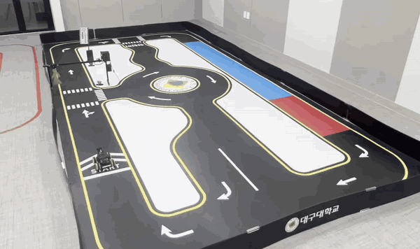
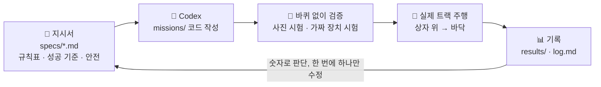
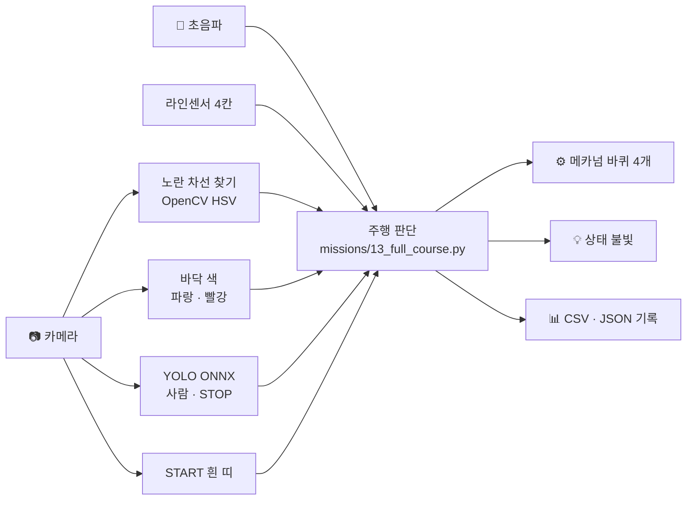

<div align="center">

# 🚗 라즈봇 자율주행 — 대구대 PBL 3조

**카메라 한 대로 트랙 한 바퀴를 스스로 달리는 소형 자율주행차**<br>
차선을 따라가고, 바닥 색으로 속도를 바꾸고, 사람·STOP 앞에서 멈췄다가, START 흰 선에서 스스로 정지합니다.


[English](README.en.md) · [실행 설명서](docs/RUN.md) · [주행 기록](results/) · [지시서](specs/)



<sub>학교 트랙 큰길 한 바퀴 · 4배속 · 2026.11.05</sub>

</div>

## 한눈에 보기

| 실제 트랙 완주 | 모서리 맞힘 | 전체 경로 맞힘 | 표지 인식 |
|:---:|:---:|:---:|:---:|
| **7 / 7판** FINISH<br><sub>11/6, 37~44초</sub> | **28% → 81%**<br><sub>사진 시험</sub> | **60% → 87%**<br><sub>사진 시험</sub> | **18 → 26 / 30장**<br><sub>YOLO 320 → 640</sub> |

- **기간**: 2026.11.1 ~ 11.6 (6일) · 대구대 「AI 자율주행 알고리즘 PBL」
- **팀 역할**: 조장 · 운전석 · 트랙·표지 · 측정 · 기록·발표. 이 레포 주인은 **조장**입니다.
- **하드웨어**: Yahboom RASPBOT-V2 (메카넘 바퀴 4개 · 카메라 짐벌 · 초음파 · 라인센서 4칸 · RGB 불빛) + Raspberry Pi 5

## 주행 영상

**큰길 한 바퀴** (외부 시점, 33초)

https://github.com/user-attachments/assets/10f29714-b9fe-476f-a1fe-a59d78784a65

**마지막 주행 · 상태 불빛** (11/6, 로봇 카메라 시점. 오른쪽 위 불빛 색은 주행 기록으로 다시 그린 것)

https://github.com/user-attachments/assets/97b09148-425d-42a5-866d-6aba71688487

**로터리 단독 시험** (18초, 마지막에 흰 바닥으로 이탈 — 다음 과제)

https://github.com/user-attachments/assets/eed7b209-75b9-433f-b449-a0a8d11d4d99

<sub>원본 화질 다운로드: [큰길 한 바퀴](https://github.com/jihooni217/raspbot-pbl-3team/releases/download/demo-20261106/raspbot_outer_lap_20261105.mp4) · [로터리 시험](https://github.com/jihooni217/raspbot-pbl-3team/releases/download/demo-20261106/raspbot_rotary_test.mp4)</sub>

## 내 역할 (조장 · 주도)

- **지시서 작성**: 기능마다 지시서를 직접 썼습니다. 지시서에는 목표, 규칙표, 숫자로 된 성공 기준, 안전 규칙이 들어갑니다. AI(Codex)는 이 지시서대로만 코드를 쓰도록 규칙([`AGENTS.md`](AGENTS.md))을 정했습니다.
- **발표 시연 코드(13번) 완성**: 차선 따라가기, 바닥 색 속도, 사람·STOP 정지, START 정지를 한 프로그램에 합쳤습니다. 실제 트랙에서 직접 돌려 보며 7판 모두 완주할 때까지 맞췄습니다.
- **검증과 기록**: 고친 코드는 바퀴를 돌리기 전에 사진과 가짜 장치로 먼저 시험했습니다. 실제 주행은 판마다 `results/`에 기록을 남기고, 느낌이 아니라 숫자로 판단했습니다. 큰길 주행 기록만 60판이 넘습니다.
- **원인 찾기**: 주행 기록과 로봇 카메라 영상을 나란히 놓고 어디서 틀렸는지 찾았습니다. 고칠 때는 한 번에 하나만 바꿨습니다 (아래 문제 해결 사례).
- **레포 관리와 발표**: GitHub 정리, 시연 구성, 발표 자료.

<sub>**팀**: 로터리 · 천천히 표지 등 일부 시도는 조원 브랜치(`mission-10-rotary`, `mission-08-slow-scurve-logo`)와 PR로 진행했습니다.<br>
**AI 도구**: 코드는 Codex가 지시서대로 작성했고, 로봇 접속 확인 · 기록 정리 · 커밋은 Claude의 도움을 받았습니다.</sub>

## 어떻게 만들었나



- 사람은 **무엇을, 왜, 어떤 숫자가 나오면 성공인지**를 정합니다. 코드는 AI가 씁니다.
- 안전 규칙은 지시서마다 들어갑니다. 예: 바퀴 속도는 150을 넘지 않는다, 바퀴를 돌리기 전에 꼭 확인한다.
- 모서리는 실제로 몇십 번씩 달려 보기 어렵습니다. 그래서 로봇을 손으로 밀며 한 바퀴 사진 1,798장을 찍고, 코드가 이 사진에서 맞게 판단하는지 점수를 매기는 **사진 시험 도구**([`tools/photo_lap_test/`](tools/photo_lap_test/))를 만들었습니다.

## 시스템 구조



| 상황 | 동작 |
|---|---|
| 평소 | 노란 차선 따라 속도 35 · 불빛 초록 |
| 파란 바닥 | 속도 80으로 가속 · 불빛 파랑 |
| 빨간 바닥 | 속도 25로 감속 · 불빛 노랑 깜빡임 |
| 사람 모형 · STOP · 앞 장애물 25cm | 멈춤 · 불빛 빨강 → 사라지면 재출발 |
| 빨간 바닥 지난 뒤 START 흰 띠 + 라인센서 4칸 모두 흰색 | 한 바퀴 완료, 정지 |

## 주요 기능

| 번호 | 프로그램 | 하는 일 |
|---|---|---|
| **13** | [`13_full_course.py`](missions/13_full_course.py) | **발표 시연 코드.** 큰길 한 바퀴 · 바닥 색 속도 · 사람/STOP/장애물 정지 · START 정지 · 상태 불빛(`--lights`) |
| 07 | [`07_lap_1757.py`](missions/07_lap_1757.py) | 카메라로 노란 차선 따라가기 (13의 바탕) |
| 08 | [`08_command.py`](missions/08_command.py) | 한국어 글 명령 → AI가 **정해진 동작 11개 중 하나만** JSON으로 고름. 목록 밖·두 가지 이상·위험한 요청은 거절 (가드레일) |
| 09 | [`09_dashboard.py`](missions/09_dashboard.py) | 브라우저 조종판 (자동주행 ON · 긴급 정지 · 실시간 로그) |
| 14 | [`14_camera_align.py`](missions/14_camera_align.py) | 출발 전 카메라 각도 자동 보정 |
| 05·06 | [`05_signs.py`](missions/05_signs.py) · [`06_drive_signs.py`](missions/06_drive_signs.py) | YOLO로 사람·STOP 찾기, 달리며 정지 |
| 04 | [`04_obstacle.py`](missions/04_obstacle.py) | 초음파 중앙값으로 장애물 25cm 앞 정지, 35cm 넘으면 재출발 |
| 02 | [`02_line.py`](missions/02_line.py) | 라인센서로 검은 선 따라가기 |
| 03 | [`03_video.py`](missions/03_video.py) | 블랙박스 녹화 (시각·거리·상태 글자) |

## 문제 해결 사례

<details>
<summary><b>① 모서리에서 벽으로 가는 문제 — 기준이 없어서 고칠수록 나빠짐</b></summary>

- **문제**: 차선 코드를 고칠수록 모서리에서 벽으로 가거나 멈췄습니다. 고친 버전이 여러 개 섞여서, 어느 쪽이 나은지도 알 수 없었습니다.
- **원인 찾기**: **사진 시험 도구**를 만들어, 같은 사진 1,798장으로 버전마다 점수를 매겼습니다.
- **결과**: 세 버전의 점수는 83% · 28% · 24%였습니다. 가장 좋은 버전을 기준으로 정하고, 선에서 조금만 벗어났을 때는 핸들을 덜 꺾게 고쳤습니다. 모서리 **81%**, 직선 흔들림 43 → 30. 다른 값(80px)으로 바꾼 시도는 79%로 오히려 낮아서 되돌렸습니다.
</details>

<details>
<summary><b>② 바닥 빛 반사로 차선을 놓침 — 코드 대신 카메라 값을 고침</b></summary>

- **문제**: 마지막 모서리 뒤에서 바닥 빛 반사 때문에 노란 점이 부족해져 선을 놓쳤습니다.
- **해결**: 코드는 그대로 두고 카메라 값을 바꿨습니다. 노트북에서 카메라 화면을 보며 밝기와 색을 조절하는 도구(`tools/camera_tuner.py`)를 만들고, 카메라가 스스로 밝기를 바꾸지 못하게 고정했습니다. 찾은 값은 [`tools/camera_track_values.sh`](tools/camera_track_values.sh) 한 줄로 다시 넣을 수 있습니다.
- **결과**: 차선이 아닌데 노랗게 잡히던 점이 111개 → 2개로 줄었습니다. 같은 값으로 **3판 연속 완주** (34.8 · 34.0 · 32.7초), 선을 놓친 횟수 0번.
</details>

<details>
<summary><b>③ 출발선을 지나쳐 버림 — 타이머 대신 두 센서로 확인</b></summary>

- **문제**: 처음에는 "빨간 바닥이 끝나고 7.4초 뒤에 멈춘다"는 타이머를 썼습니다. 그런데 속도가 조금만 달라도 멈추는 자리가 바뀌었습니다.
- **해결**: 시간 대신 눈과 발로 확인하게 했습니다. ① 빨간 바닥을 지난다 → ② 카메라가 START 흰 띠를 0.2초 동안 본다 → ③ 바닥 라인센서 4칸이 모두 흰색을 밟으면 멈춘다.
- **추가 수정**: 실제 주행에서 흰 선을 너무 빨리 지나가 한 번만 읽히고 멈추지 못한 판이 있었습니다. 그래서 두 번 연속 읽어야 멈추던 것을 **한 번만 읽어도 멈추게** 바꿨습니다.
</details>

<details>
<summary><b>④ 다시 출발해도 불빛이 빨강 그대로 — 명령 한 번이 사라짐</b></summary>

- **문제**: STOP에서 빨강으로 바뀐 뒤 다시 출발해도 빨강이 남는 경우가 있었습니다.
- **원인**: 색이 바뀔 때 딱 한 번만 불빛 명령을 보냈습니다. 그 한 번이 중간에 사라지면 다시 고칠 기회가 없었습니다.
- **해결**: 색이 그대로여도 **0.5초마다 다시 보내게** 했습니다. 불빛은 주행과 따로 도는 스레드에서 보내서, 불빛이 늦어져도 주행이나 안전 정지가 멈추지 않습니다.
</details>

<details>
<summary><b>⑤ 장애물 정지 거리가 들쭉날쭉 — 규칙을 숫자로 다시 정함</b></summary>

- **문제**: 처음 규칙은 "15cm에서 멈추고 25cm에서 다시 출발"이었습니다. 첫 시험에서 상자 약 1cm 앞까지 가서 실패했습니다. 속도 50에서는 멈추는 데 약 10cm가 더 필요했습니다.
- **해결**: 초음파 거리를 여러 번 재서 가운데 값을 쓰게 하고(튀는 값 무시), 25cm에서 멈추고 35cm에서 다시 출발하도록 바꿨습니다.
- **결과**: 상자 앞 12~18cm에 멈추면 통과로 보고, **5번 중 4번 통과**했습니다.
</details>

## before → after

| 항목 | before | after |
|---|---|---|
| 장애물 정지 거리 (12~18cm 안) | 1/1 실패 | 4/5 통과 |
| YOLO 표지 30장 | 18/30 (320 모델) | 26/30 (640 모델) |
| 카메라 차선 모서리 맞힘 | 28% | 81% |
| 전체 코스 경로 맞힘 | 60% | 87% |
| 속도 구간 (가속·감속, 사진 시험) | 0/5 | 5/5 |
| 글 명령 (바퀴 안 쓰는 시험) | — | 예문 10/10 · 거절 3/3 · 바꿔 말하기 5/5 |
| 글 명령 (11/6 상자 위 실물) | — | 예문 10/10 · 거절 3/3 · AI 판단 최대 9.46초 |
| 실제 트랙 큰길 한 바퀴 (11/6) | — | 7판 모두 FINISH, 37.3~43.8초 |
| 우리만의 기능: 바닥 색 속도 (11/6 실주행) | — | 7판 모두 파란 구간 약 5.5초 가속, 빨간 구간 평균 25 |
| 달리다가 정지 (11/6 실주행) | — | 사람 모형 5판, 왼쪽 STOP 4판. 오른쪽 자리 STOP은 인식 못함 |
| 로터리 시험 (11/5) | — | 7판 중 1판 한 바퀴. 안정화는 다음 과제 |

## 남은 한계와 다음 과제

- **로터리**: 지금은 차선을 따라 돌다가 가까운 다른 차선을 따라가 벗어납니다. 다음에는 가운데 **마크 로고를 기준으로** 도는 방식으로 바꿀 계획입니다.
- **사람 정지**: 가까이서야 멈추고, 안 보이면 약 1.3초 뒤 재출발합니다. 조정한 카메라 값에서 검은 바닥 판정이 맞지 않는 것이 원인입니다.
- **STOP 정지**: 오른쪽 자리 STOP은 인식하지 못했고, 정지 표시가 있었는데 멈추지 않은 판도 있었습니다.
- **천천히 표지**: 직접 학습한 모델(`models/slow_v1~v3`)로 사진 인식까지 했고 주행에는 넣지 않았습니다.
- **바닥 색 오인**: 옆 판을 파란 바닥으로 약 0.9초 잘못 본 판이 있고, 빛 반사에 약합니다.

## 폴더 구조

```
missions/   기능별 프로그램 (02~14)
specs/      기능별 지시서 — 목표 · 규칙표 · 성공 기준 · 안전 · 결과 기록
tools/      점검 · 시험 · 재생 도구 (사진 시험: tools/photo_lap_test/)
results/    실주행 · 시험 기록 (CSV · JSON · TXT)
models/     YOLO 모델 (강사 제공) + 직접 학습한 천천히 표지 모델
docs/       실행 설명서 · 점검 기록 · 그림
log.md      막힌 것과 해결 기록
AGENTS.md   AI(Codex) 작업 수칙
```

## 실행

로봇 접속부터 트랙 주행까지 모든 명령은 **[docs/RUN.md](docs/RUN.md)** 에 있습니다.

```bash
sh tools/camera_track_values.sh                            # 카메라 값 맞추기
python3 missions/13_full_course.py --outer-lap --check     # 바퀴 없이 판단만 보기
python3 missions/13_full_course.py --outer-lap --lights    # 큰길 한 바퀴 + 상태 불빛
```

## 공개 원칙

- 사람 얼굴이 나온 사진·영상, 비밀번호·API 키는 레포에 올리지 않습니다. 그래서 `results/`의 사진 일부와 학습용 사진은 빠져 있습니다.
- 바퀴 속도 상한 150 (데모 35/80/25), 바퀴 돌리기 전에 상자 위·바닥 확인.
